# System Design

## 1. The Core Idea
The ingest request ends at a PostgreSQL commit. All alerting happens afterwards and is driven by Kafka.

In the monolith, alert work ran inside the ingest request, which is why ingest stalled every morning. Splitting at the commit lets each part scale on its own:

- Ingest scales on CPU and database write IOPS.
- Alerting scales on Kafka partitions and consumer lag.
- Reads scale on Redis and read replicas.

Correctness never relies on the network or the cache:
- Every write has a database-enforced natural key.
- Every event goes through a transactional outbox.
- Every consumer is idempotent.

## 2. Architecture Diagram


<details>
<summary>Mermaid source (edit, then re-export the SVG)</summary>

```
architecture-beta
    %% ---------- Clients ----------
    service dev(mdi:cellphone-link)[Devices]
    service coach(mdi:tablet-cellphone)[Coach App]

    %% ---------- Edge / compute ----------
    service apigw(logos:aws-api-gateway)[API Gateway]
    service ingest(server)[ingest api]
    service query(server)[query api]

    %% ---------- Data stores ----------
    service pgw(database)[PostgreSQL Write DB Readings and Outbox]
    service pgr(database)[PostgreSQL Read Replica]
    service redis(logos:aws-elasticache)[Redis Cache]

    %% ---------- Streaming / alerting ----------
    service cdc(server)[CDC Debezium]
    service msk(logos:aws-msk)[Amazon MSK Kafka]
    service eval(server)[Alert Evaluator]
    service nq(logos:aws-sqs)[Notification Queue]
    service notif(server)[Notification Consumer]
    service push(logos:aws-sns)[Push SNS]
    service sms(logos:aws-sns)[SMS]

    %% ---------- Write path ----------
    dev:R --> L:apigw
    apigw:R --> L:ingest
    ingest:R --> L:pgw
    pgw:B --> T:cdc
    cdc:R --> L:msk
    msk:R --> L:eval
    eval:R --> L:nq
    nq:R --> L:notif
    notif:T --> B:push
    notif:R --> L:sms

    %% ---------- Read path ----------
    coach:T --> B:apigw
    apigw:T --> B:query
    query:R --> L:redis
    query:B --> T:pgr
    pgw:R --> L:pgr
```

</details>

## 3. Scaling to ~1M active devices and ~50M readings/day, Morning burst of 60% activities in 6-9 AM window

 - At 50M readings/day, putting 60% of the volume in the 6-9 AM window gives about 2,800 readings/s sustained, and device reconnect bursts can push that to about 15,000 readings/s (about 3,000 requests/s with batches of 5), so the design is sized for the burst, not the daily average of about 580/s. 
 - The ingest path stops at a single short PostgreSQL transaction: one multi-row `INSERT … ON CONFLICT DO NOTHING` plus one outbox row per batch, with no alert evaluation, notification or LLM call on the request, so ingest cost stays flat as downstream work grows.
 - The ingest-api pods are stateless, run on Java 21 virtual threads behind PgBouncer, autoscale on CPU and in-flight requests, and are pre-scaled from 5:30 AM so capacity is in place before the burst starts. 
 - Alerting is decoupled through the outbox and Kafka: `readings.ingested` has 128 partitions keyed by `patient_id`, so up to 128 evaluator pods can work in parallel while each patient's readings stay in order, and KEDA adds pods as consumer lag grows. The evaluator processes up to 500 events  of work per transaction with set-based SQL and HOT updates, turning about 3,000 breaches/s into a few hundred commits/s, while `synchronous_commit` stays on so durability is never traded for speed. 
 - Reads are served from Redis and read replicas with keyset pagination, so coach traffic never competes with the morning write load on the primary. 
 - Storage holds about 8 GB/day in daily time partitions with 90 days hot, and because every hot query and Kafka key is scoped to `patient_id`, the database can grow from one primary to separate ingest and alerting databases and then shard by `patient_id` without a redesign. 
 - Separate deployables per scaling profile. Ingest, alerting and reads scale independently, so a morning ingest spike can't starve the coach UI. Daily partitions are managed by pg_partman. After 90 days a partition is detached, written to Parquet on S3 with Object Lock, then dropped. Rollup tables serve trends and AI summaries, so raw rows are never scanned for long ranges.


## 4. Data at Scale
These Ideas keep data at scale manageable
 
 1. Time partitioning
    - Partitions created ahead of time: p_premake = 7 creates them 7 days in advance, so ingest never waits on DDL at 6 AM.
    - A range query touches only the days it covers (partition pruning), and indexes stay sized to one day.
    - Data is shared on timestamp, each unique key include partition key, Deduplication stays a cheap check inside one partition.
 2. Retention & Archival
    - Postgres keeps 90 days (retention = '90 days'). Old partitions are detached and later dropped, so there is no vacuum storm and no table bloat.
    - Detached partitions are exported  to Parquet on S3 (encrypted, Object Lock), moves it to Glacier after 1 year, and keeps it for the legal retention period (assumed 7 years).
 3. Rollups instead of raw scans
    - reading_rollup holds min, max, average and count per patient, per measure, per hour. It is filled by RollupJob and keyed by (patient_id, measure_code, hour_start), so rebuilding a rollup is idempotent.
    - Trends and the AI summary read the rollups, so a 30-day view reads about 720 hourly rows instead of thousands of raw readings.
 4. Batched evaluation of Alerts and notifications: the evaluator works in set-based batches of up to 500 events or 200 ms.
 5. Every hot query and every Kafka key is scoped to patient_id, so the storage layer can grow in stages 


## 5. Correctness under Stress
Every hop is at-least-once: devices retry, Debezium re-publishes, Kafka redelivers, and pods crash
or rebalance. Each invariant below is therefore enforced by a constraint on the database shard that
owns the patient, so a repeat is a no-op however many pods, partitions or regions are involved.

1. A reading acknowledged with 202 is never lost and is stored exactly once.
   202 is returned only after a synchronous_commit to Aurora's 6-way, 3-AZ quorum, so an
   acknowledged reading survives an AZ or writer failover. A retry, even one that reaches two pods
   at once, hits the primary key (device_id, reading_uuid, measured_at) and is absorbed by
   ON CONFLICT DO NOTHING.
2. Each breaching reading is counted exactly once in its alert episode.
   Debezium restarts and Kafka redeliveries both re-send the same event. The evaluator inserts an
   alert_occurrence row keyed by the reading in the same transaction as the episode update, and it
   commits the Kafka offset only after the database commit. A replayed event hits the primary key
   and rolls back the whole transaction, so the count and the outgoing events stay unchanged.
3. Each patient and measure has at most one unresolved alert episode.
   Every topic is keyed by patient_id, so one consumer at a time owns a patient. A zombie consumer
   after a rebalance, or an overlapping batch, still runs into a unique partial index on
   (patient_id, measure_code) for unresolved alerts plus a FOR UPDATE row lock on that shard. A
   second breach is therefore folded into the existing episode instead of creating a new one.
4. Every CRITICAL episode produces a notification for the responsible coach on every required
   channel; missing one is never acceptable, a rare duplicate is tolerated.
    - Never lost: the episode and its event are written in the same transaction (outbox). MSK
      uses acks=all, min.insync.replicas=2 and RF=3, so the event survives broker and AZ loss.
    - Isolated: CRITICAL alerts have their own topic, consumer group and pods.
    - Recorded once: UNIQUE (trigger_event_id, coach_id, channel) stores one notification row.
    - Retried: senders retry PENDING rows with notification_id as the provider's idempotency
      key. If a crash lands between the send and the SENT update, a rare duplicate is accepted on
      purpose rather than risking a missed alert.
5. A CRITICAL alert still OPEN at escalate_at is escalated exactly once, and never after it has
   been acknowledged.
    - Timer survives failover: escalate_at is a database column, and a
      CHECK (escalate_at only on OPEN + CRITICAL) constraint keeps it valid. The timer fails over
      with the shard and depends on no pod's memory or clock.
    - Only one pod escalates: schedulers on any number of pods claim due rows with
      FOR UPDATE SKIP LOCKED and a status = 'OPEN' guard.
    - Acknowledgement cancels it: acknowledging clears escalate_at in the same conditional
      update, so a late scheduler matches zero rows.
6. Alert state only moves along legal transitions, and every change is audited.
   Every transition is one conditional
   UPDATE … WHERE version = ? AND status IN (legal sources) on the primary. A stale screen from a
   lagging replica, or a race between two coaches, gets 409 with the current state instead of a
   lost update. The same transaction writes the audit_log row (insert-only role) and the
   alert.state_changed outbox event, so no state change can exist without its audit record and
   announcement.

## 6. Healthcare security compliance
Readings are PHI, so the design applies HIPAA Security Rule safeguards in the architecture itself,
not only as policy. Every AWS service in the PHI path is HIPAA-eligible and covered by the AWS BAA.

1. Minimum necessary data.
   The service stores patient_id and measured values only, never names, contact details or free
   text. A breach of any one store therefore exposes no direct identifiers.
2. No PHI leaks through events, logs or telemetry.
   Kafka payloads, logs, traces and metric labels carry IDs and values only. A log scrubber blocks
   PHI-tagged fields, and exception messages never include request bodies. MSK, CloudWatch and
   X-Ray never hold more than a pseudonymous ID.
3. Strong identity for every caller.
    - Devices: per-device API keys, stored as HMAC-SHA256 with a pepper held in KMS, so keys can
      be rotated and revoked.
    - Coaches: sign in with OIDC through Cognito, with scoped tokens.
    - Services: OAuth2 client credentials with narrow scopes.
4. Access limited to the coach's own panel, enforced twice.
    - In the service: query-api checks every coach request against the coach's current
      care_assignment.
    - In the database: Postgres row-level security enforces the same rule again, on every shard
      and read replica.

   A bug in application code alone therefore cannot expose another coach's patients.
5. A device can write only for its bound patient.
   Ingest checks the device↔patient binding at each reading's measured_at and returns 403
   otherwise. A stolen or rebound device key cannot inject readings into another patient's record.
6. Encryption in transit and at rest.
    - In transit: TLS 1.2+ on every hop (gateway, service mesh mTLS, Aurora, MSK, ElastiCache).
    - At rest: KMS-managed keys for Aurora, MSK, ElastiCache, EBS and S3, with key rotation and
      access logged in CloudTrail.
7. Tamper-proof audit trail.
    - What is audited: every PHI read and every alert state change writes audit_log (actor,
      action, ALLOWED/DENIED, patient, request id) in the same transaction.

## 7. Observability
Observability is organised around the SLOs first, then the golden signals of each stage, then business and clinical signals. These rules apply to every metric.
1. SLO metrics
   - Critical alert delivered fast, p99 > 5 s for 5 min
   - Ingest responsiveness: p99 > 150 ms (warn), > 300 ms for 5 min
   - Ingest availability:  5xx > 0.5%; shed rate > 5%
   - Any CRITICAL alert missed: Raise an alarm
   - Any alert not escalated with in 60 sec: Raise an alarm
2. Per-stage pipeline metrics
   - Ingest (API Gateway → ingest-api) : Requests/s, readings/s, Latency for batch ingestion
   - Outbox and CDC (Debezium on MSK Connect): Age of the oldest outbox row and number of rows waiting. Debezium replication lag in bytes and seconds.
   - Kafka: Consumer lag in records and seconds per group and partition.
     - Critical lane (notifier-critical): page above 5 s.
     - alert-evaluator: page above 60 s.
   - Notifier and senders: Notifications created and sent per channel and severity, send latency, Provider error rate, Waiting (PENDING) queue depth
   - query-api
     - Latency for latest-reading, range and coach-queue queries
     - Redis hit ratio and cache misses that fall back to a replica.

## 8. Response of Live Incident
Diagnosis

1. First I check that CRITICAL alerts are still on time: critical-alert p99 and notifier-critical lag. Then I tell coaches that readings and alerts are delayed, not lost.
2. Ingest doesn't depend on Kafka or the alert workers, so the three symptoms together point to one shared resource: the Aurora primary, PgBouncer, or Redis.
3. Ingest latency by stage shows where the time goes. Slow auth points to Redis. Slow insert or commit points to the database. Waiting before any step points to pods or the connection pool.
4. Next I see which queue is backing up. If outbox age is high but Kafka lag is low, Debezium is stuck. If evaluator lag is high, the database is slow. If unsent notifications pile up, the SMS/push provider is the problem.
5. On the database, a lock wait with normal CPU means partition maintenance or a migration is blocking inserts. Rising CPU together with more evaluator pods and per-event fallbacks means the evaluator is overloading it. High pool wait with moderate CPU means too many pods.
6. I compare all of this with the change log: deploys, migrations, partition jobs and scaling events since 6 AM. A step change usually lines up with one of them.

Stabilizing

1. First I stop whatever is adding load. I freeze evaluator autoscaling, then pause the AI triage, rollup, digest and non-critical notifier consumers. The evaluator and the critical notifier keep running.
2. If a lock is the cause, I cancel the blocking session and turn off partition maintenance until 10 AM. Before that, I confirm today's partition exists and the DEFAULT partition has 0 rows.
3. I lower ingest's in-flight limit so it returns 503 with a randomized Retry-After. Devices keep their readings and resend them, and duplicates are dropped, so no data is lost.
4. Then the cause-specific fix:
    - a bad release gets rolled back;
    - too many ingest pods get scaled down;
    - a failing Redis node gets failed over;
    - a poison event goes to the DLQ;
    - degraded writer storage means an Aurora failover.
5. Coach reads stay on the replicas, because moving them to the primary would add load where it's already overloaded. Coaches get the current delay and the critical-alert p99 every 15 minutes.
6. I call it stable when:
    - ingest p99 is under 300 ms;
    - pool wait is under 100 ms;
    - outbox age and evaluator lag are falling steadily;
    - critical p99 is under 5 s.

Restoring

1. I turn paused work back on in reverse order, one step at a time: non-critical notifier, then digests, then AI triage, then the rollup job.
2. After each step I wait a few minutes. I move on only if pool wait and evaluator lag stay flat.
3. Then I put autoscaling limits and the ingest in-flight limit back to normal. The partition maintenance schedule comes back after 10 AM, with a lock timeout set.
4. I let Kafka work through the backlog in order. Duplicate handling makes those replays safe, and the critical lane stays isolated the whole time.
5. Before closing, I check the data:
    - every CRITICAL episode has a notification;
    - no escalations are overdue;
    - the DLQ is triaged;
    - the DEFAULT partition is empty.
6. Last, I close the incident with coaches, open a blameless postmortem, and add the queries and the decision steps above to the runbook. 

## 9. Tradeoffs
1. Outbox relay instead of CDC
2. Single Database for both Read and Write traffic
3. Service level authentication for Device and Coach/Clinician, For production it should be API Gateway level, Also Rate limiting and other concerns handled at API gateway.